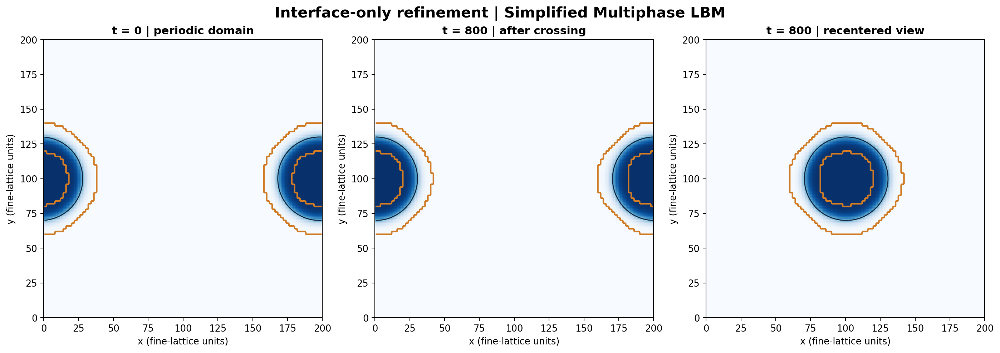
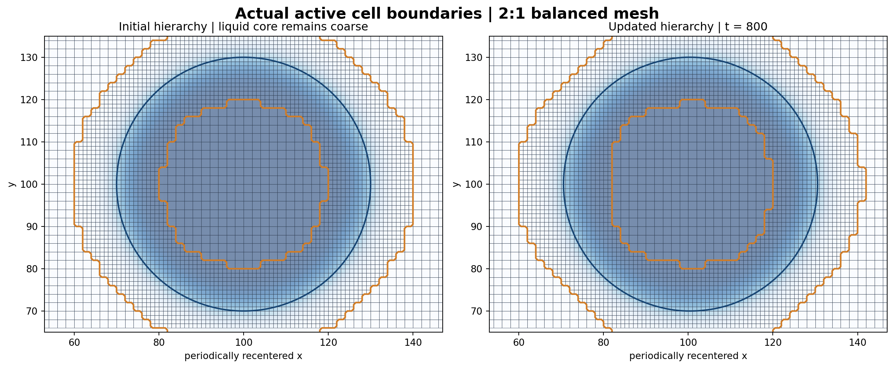
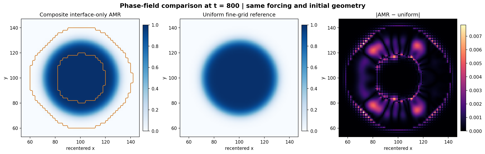
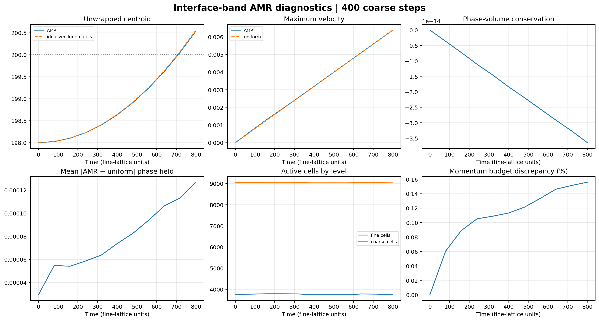
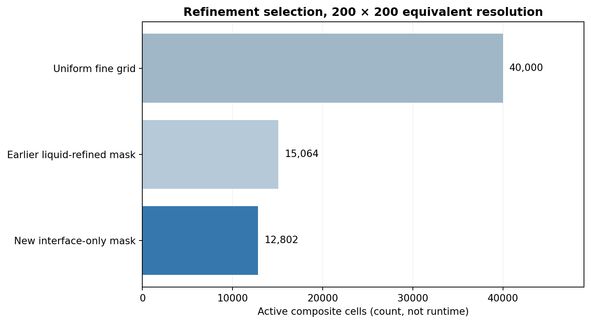

# Interface-Focused Hierarchical Mesh for Moving Droplets

**Simplified Multiphase Lattice Boltzmann Method (SMLBM)** | Numerical research portfolio

This demonstration combines a dynamically updated **two-level Cartesian hierarchy** with a small streamwise body acceleration to model an immiscible droplet moving across a periodic boundary. Unlike a liquid-region refinement strategy, the **fine grid follows only the diffuse interface**; the droplet core and surrounding gas remain on the coarse level wherever permitted by the refinement buffer.

## Refinement strategy

Refinement is triggered by a phase-field window:

**0.2 < φ < 0.8**

The tagged interface is expanded by **four coarse cells** to give a numerical stencil buffer. Refinement is **periodic in x and y** and updated every **five coarse time steps**. The resulting hierarchy is **2:1 balanced**.

The figure shows real cell boundaries from the interface-only run, not a schematic or a relabeling of an earlier liquid-refined simulation. The blue phase-field contour locates the droplet, while the orange outline marks the fine-region boundary.

## Simulation configuration

| Parameter | Value |
|---|---|
| Domain | 200 × 200 finest-resolution equivalent |
| Droplet radius | 30 fine-lattice units |
| Interface thickness | 8 fine-lattice units |
| Grid refinement | 2:1, adaptive fine annulus |
| Coarse/fine spacing | 2 / 1 |
| Coarse/fine time step | 2 / 1 |
| Body acceleration along x | 8 × 10⁻⁶ in fine lattice units |
| Boundary conditions | Periodic in both directions |
| Initial droplet centre | (198, 100), across the periodic seam |
| Refinement interval | Every 5 coarse steps |
| Evaluation interval | 400 coarse / 800 fine time steps |

## Results at fine time t = 800

| Quantity | Observed value |
|---|---:|
| Unwrapped x-centroid | 200.53943 |
| Wrapped x-centroid | 0.53943 |
| Maximum lattice speed | 0.006385 |
| Phase-volume relative error | -3.646e-14 |
| AMR–uniform mean absolute φ difference | 1.268e-04 |
| Regridding events | 43 |
| Fine and coarse active cells | 3,736 / 9,066 |
| Active composite cells | 12,802 of 40,000 |
| Momentum-budget relative discrepancy | 0.156% |

The droplet's centroid crosses the periodic seam while the refinement region tracks the surface. **These are short-run validation results**, not the longer results previously obtained with liquid-interior refinement.

## Scope and limitations

- The numerical formulation is identified publicly only as **Simplified Multiphase LBM**. Unpublished solver equations, detailed coupling procedures and source code are **not distributed**.
- Conservation of phase volume is excellent in this case, but rigorous coarse–fine **momentum-flux conservation remains to be established**.
- Interface-only refinement reduces active cell counts, not necessarily runtime: this prototype still computes full arrays at both levels.
- The previous longer run, which refined the liquid interior, is not represented as an interface-only validation result. The interface-band scheme needs its own long-duration and resolution-convergence testing.

© 2026 Md Sujaat Ali. Portfolio showcase; all rights reserved.
