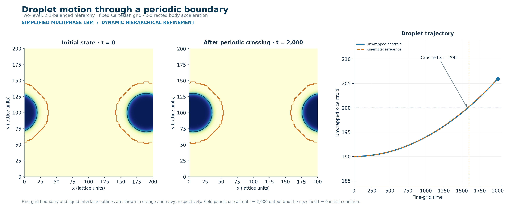
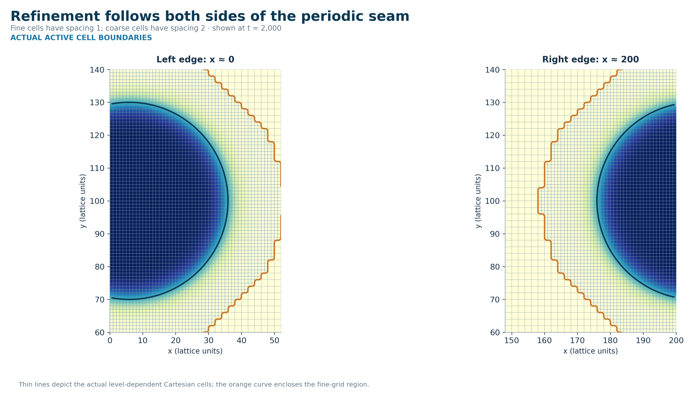
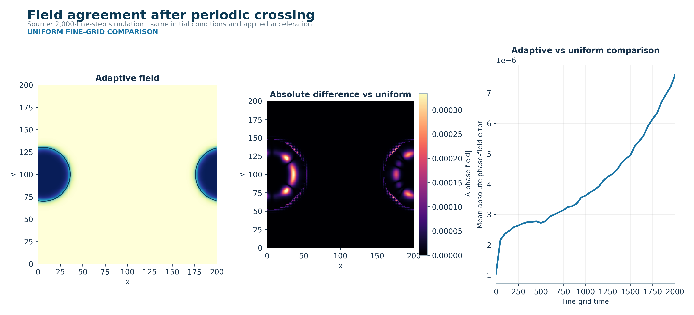
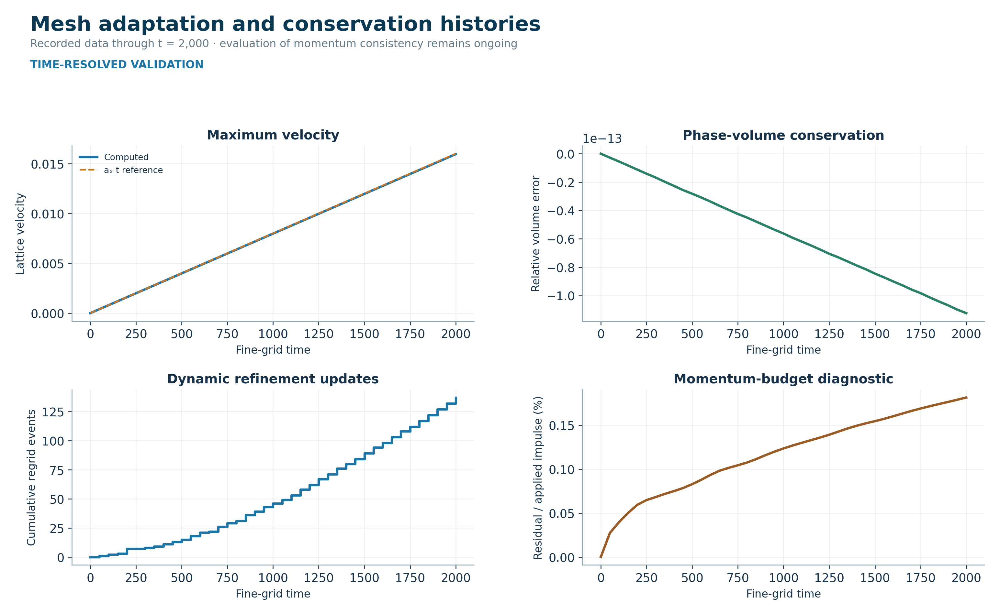
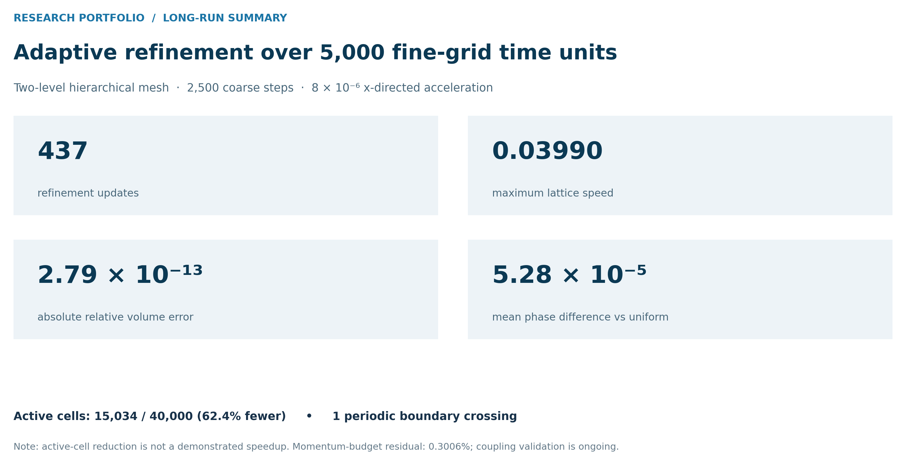

# Dynamic Hierarchical Mesh Refinement for Droplet Motion

**Simplified Multiphase Lattice Boltzmann Method (SMLBM)** · Numerical simulation portfolio

This project demonstrates a two-level, dynamically updated Cartesian hierarchy for a translating liquid droplet. A small body acceleration drives the droplet in the **x direction**, while periodic boundaries allow it to cross the domain edge without interruption. The refinement region tracks the liquid and its diffuse interface as the droplet moves.

The public repository is a **visual and validation-focused project showcase**. The full research solver, numerical implementation, and unpublished methodological details are intentionally not included.

## Project highlights

- **Method:** Simplified Multiphase Lattice Boltzmann Method, with a two-level Cartesian mesh hierarchy.
- **Spatial refinement:** 2:1 coarse-to-fine ratio; fine spacing 1, coarse spacing 2 (lattice units).
- **Time integration:** one coarse step corresponds to two fine steps; fine time step 1, coarse time step 2.
- **Moving refinement:** periodic update of active fine cells, maintaining a balanced hierarchy around the droplet.
- **Forcing:** small, constant streamwise acceleration, **8 × 10⁻⁶** in fine-lattice units, applied predominantly to the liquid phase.
- **Domain:** 200 × 200 finest-grid-equivalent lattice; periodic in **x and y**.
- **Initial geometry:** circular droplet, nominal radius 30 lattice units, initially centered near the right periodic boundary.
- **Comparison:** adaptive solution assessed against a uniform fine-grid simulation at the same physical time.

## Visual results

### Actual hierarchical mesh near the periodic boundary

The zoom below shows the **actual active fine and coarse cell boundaries** at a fine-grid time of **2,000**. The periodic droplet is split across the left and right edges of the displayed domain, but remains physically continuous.

### Agreement with uniform-grid reference

### Adaptation and conservation histories

## Extended run: 2,500 coarse steps / 5,000 fine-grid time units

| Quantity | Result |
|---|---:|
| x-centroid, unwrapped | 289.569 |
| x-centroid, periodic display | 89.569 |
| Maximum speed (lattice units) | 0.03990 |
| Relative phase-volume error | −2.79 × 10⁻¹³ |
| Dynamic refinement updates | 437 |
| Active composite cells | 15,034 |
| Equivalent uniform fine-grid cells | 40,000 |
| Mean absolute phase-field difference vs uniform grid | 5.28 × 10⁻⁵ |
| Relative momentum-budget discrepancy | 0.3006% |

The long run confirms that the tracked droplet crosses the periodic x boundary while the refinement region is repeatedly updated. The reduction in **active composite cells is approximately 62.4%** relative to a fully fine 200 × 200 grid; this is **not a measured runtime speedup**, since the present validation implementation still evaluates full arrays at both levels.

**Validation scope:** The phase volume remains conserved to very small relative error, and the displayed uniform-grid comparisons show close phase-field agreement. The interlevel hydrodynamic momentum-flux balance is still being investigated; the demonstration should not be presented as a fully verified momentum-conservative or optimized AMR algorithm.

## Project scope and what is public

This repository contains **selected figures, aggregate numerical results, and high-level simulation settings only**. It deliberately omits:

- the complete fluid solver and numerical source code;
- unpublished algorithmic derivations and interface-coupling implementation;
- detailed solver verification scripts and internal research notes.

The high-resolution field figures and time histories were generated from an archived run reaching **2,000 fine-grid time units**. The extended 5,000-time-unit metrics come from a **separate completed run reported in the simulation console**; its full field snapshots were not included in this portfolio. The figure labels distinguish the two datasets.

**Research context:** A compact numerical-methods showcase illustrating computational fluid dynamics, time stepping across mesh levels, dynamic refinement, numerical diagnostics, and periodic-boundary handling.

---

*Research portfolio by Md Sujaat Ali. © 2026. Source code and unpublished numerical-method details are not publicly released.*
